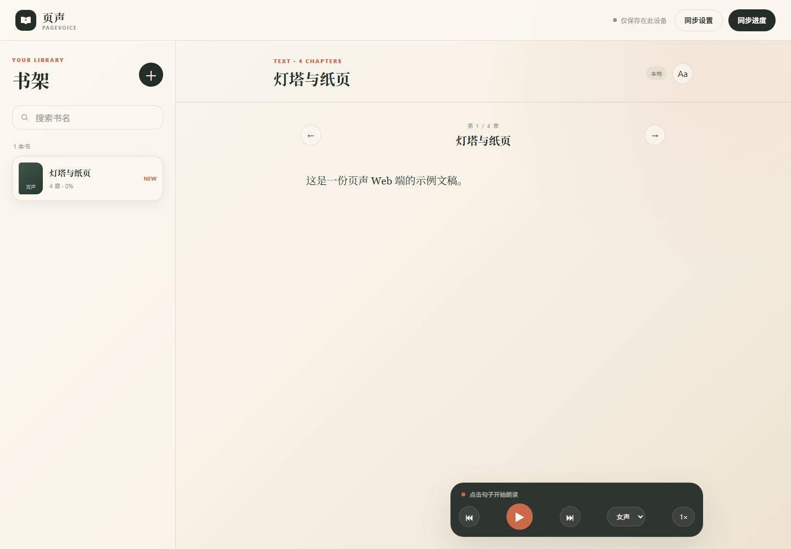
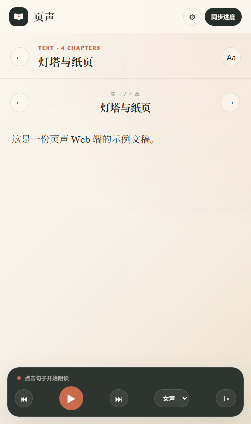
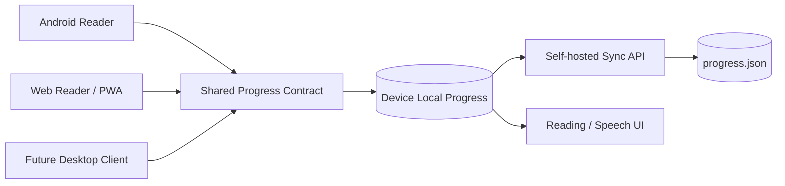
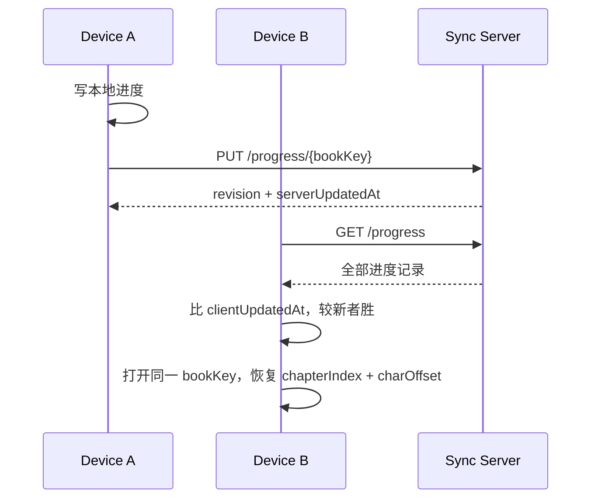

# Web 与多设备进度同步框架

## 目标

手机 App、Web 和未来的桌面客户端使用同一本书的指纹与同一条进度记录。首版同步只传阅读位置，不传正文、目录、书签或音频。



| 手机窄屏 |
| --- |
|  |

## 整体结构



每个客户端先写本地，再异步同步。同步服务离线时仍可完整阅读，不影响本地进度保存。

## 同一本书如何识别

`bookKey` 是原始文件字节的小写 SHA-256：

```text
bookKey = SHA-256(source file bytes)
```

它不使用书名、文件路径、Android 随机书籍 ID 或导入时间。因此同一份文件在不同设备上会得到相同指纹。Web 在没有安全上下文时使用纯 JavaScript SHA-256，Android 使用流式 `MessageDigest`。

当前导入的 Android 书籍会把指纹保存到 `LibraryBook.sourceFingerprint`。历史书籍没有指纹时，需要在接入 Android 网络同步前补算。

## 进度记录

规范文件：

- [JSON Schema](../shared/progress-record.schema.json)
- [OpenAPI](../shared/openapi.yaml)

```json
{
  "bookKey": "64-character-sha256",
  "chapterIndex": 2,
  "charOffset": 120,
  "pageIndex": 8,
  "percent": 0.42,
  "clientUpdatedAt": 1763450000000,
  "serverUpdatedAt": 1763450000400,
  "revision": 3,
  "deviceId": "web-..."
}
```

`chapterIndex + charOffset` 是跨客户端的主要位置；`pageIndex` 只用于 PDF 或具体布局恢复，`percent` 用于书架展示。

## 同步流



### 冲突

- 服务端接收 `clientUpdatedAt` 较新的记录。
- 时间相同则用 `deviceId` 字典序作稳定决胜。
- 旧离线事件返回 `409 stale_progress` 和服务器当前记录。
- 客户端合并服务器记录，不用旧进度覆盖新进度。

这是适合首版阅读进度的最后写入者获胜策略。设备时钟严重不一致时可能误判；下一阶段应换成服务端序号配合 HLC（混合逻辑时钟），书签和高亮再升级为 CRDT/操作日志。

## API

| 方法 | 路径 | 作用 |
| --- | --- | --- |
| `GET` | `/api/v1/health` | 无鉴权健康检查 |
| `GET` | `/api/v1/progress` | 读取个人工作区全部进度 |
| `GET` | `/api/v1/progress/{bookKey}` | 读取一本书的进度 |
| `PUT` | `/api/v1/progress/{bookKey}` | 上传较新进度事件 |

除健康检查外都需要：

```http
Authorization: Bearer <personal-token>
```

## 本地运行

需要 Node.js 20+，没有 npm 第三方依赖。

```bash
node sync-server/src/server.mjs
```

默认监听 `127.0.0.1:8787`，首次运行会生成：

```text
sync-server/data/token
sync-server/data/progress.json
```

两个文件都已被 Git 忽略。打开 `http://127.0.0.1:8787` 后，在 Web 的“同步设置”中填入终端显示或个人令牌文件中的令牌。

### 手机访问

在可信局域网内：

```bash
PAGEVOICE_SYNC_HOST=0.0.0.0 PAGEVOICE_SYNC_TOKEN="<long-random-token>" npm start --prefix sync-server
```

手机访问 `http://<电脑局域网 IP>:8787`。HTTP 局域网环境中的同步可用，但 PWA Service Worker 通常需要 HTTPS；生产部署应放在 HTTPS 反向代理后。

## 安全边界

- 当前服务是单用户自托管工作区，不提供注册、找回密码或多租户隔离。
- 令牌等同于个人工作区凭据。浏览器保存在本地存储中，不应在公共电脑填写。
- 服务只保存书籍指纹和阅读位置，不接收正文。
- Android 网络同步客户端尚未接线；现在完成的是协议、服务、Web 客户端和 Android 指纹基础。

## 当前 Web 范围

已实现：

- 本地书架与 Markdown/TXT 导入。
- 手机/电脑响应式阅读界面。
- 浏览器朗读、男女声和语速。
- 本地进度自动保存。
- 个人同步服务的上传、拉取和冲突合并。
- 纯 JavaScript SHA-256 降级与单元测试。

下一步：

1. Android `ProgressSyncClient` 接入同一 API。
2. 历史书籍指纹补算与迁移。
3. Web PDF 阅读或明确跳转 Android。
4. 书签、阅读历史和高亮同步。
5. 部署文档、HTTPS、备份和撤销令牌。
