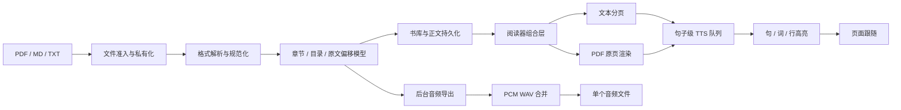
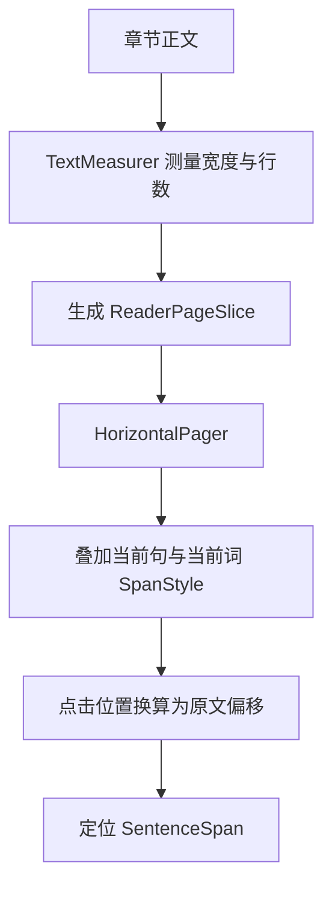
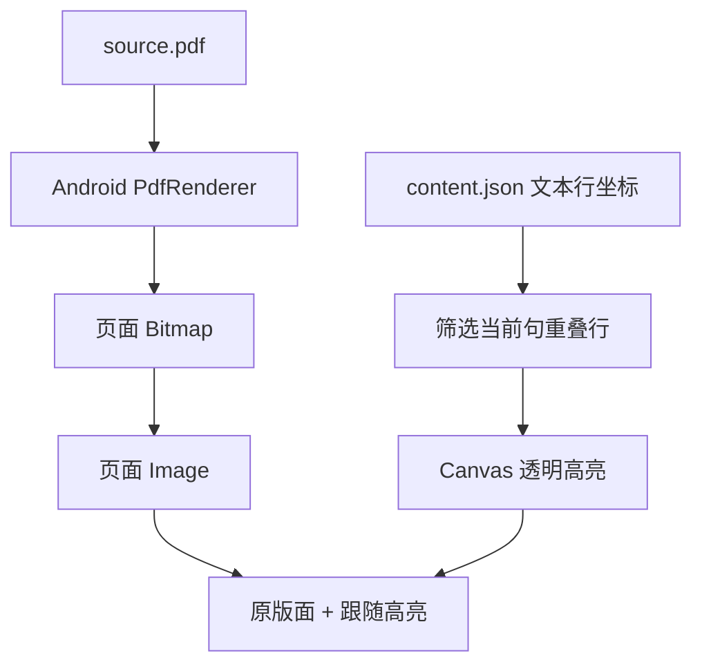
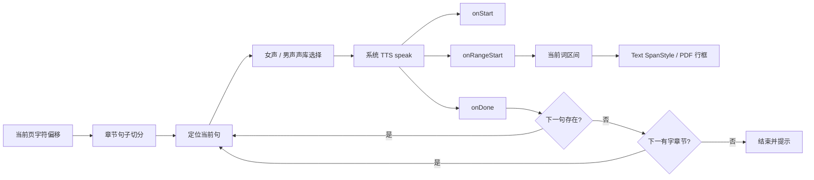
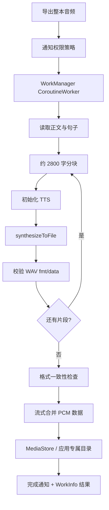
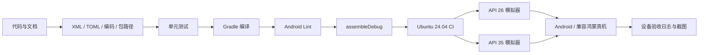

# 核心执行流水线

本文描述“从用户动作到一个可验证结果”的完整执行链。它不是部署脚本，而是产品运行时流水线，以及开发交付时必须经过的质量门。

## 1. 总览



贯穿整条流水线的核心约束是：

- 原始字符偏移用于把“读到哪里”映射回“亮到哪里”。
- 原文文件不被应用修改。
- 所有长耗时工作离开主线程。
- 可恢复的数据先持久化，临时音频不进入用户可见目录。
- 外部 TTS 与 PDF 引擎具有能力差异，流水线必须有降级状态。

## 2. 文件导入流水线

### 阶段

| 阶段 | 输入 | 输出 | 实现 | 失败行为 |
| --- | --- | --- | --- | --- |
| 选择 | 系统文件 URI | 展示名 | SAF `OpenDocument` | 用户取消，无变化 |
| 准入 | 展示名 | `BookFormat` | 扩展名白名单 | 提示仅支持 PDF/MD/TXT |
| 私有化 | 输入流 | `source.*` | `BookRepository.importBook` | 删除本次临时目录 |
| 解析路由 | 文件与格式 | `BookContent` | Markdown 或 PDF Parser | 返回可读错误 |
| 正文写入 | `BookContent` | `content.json` | Kotlin Serialization | 删除本次临时目录 |
| 元数据提交 | `LibraryBook` | `library.json` | AtomicFile + Mutex | 回滚内存书库 |
| 首屏更新 | `ImportedBook` | 书架卡片 | StateFlow | 显示成功 Snackbar |

### 数据落点

```text
filesDir/
└── books/
    ├── library.json
    └── <book-id>/
        ├── source.pdf | source.md | source.txt
        └── content.json
```

`library.json` 只保存书架元数据、封面风格和阅读进度；`content.json` 保存章节正文、目录和 PDF 行坐标。这个拆分避免每次更新进度都重写整本正文。

### 文本规范化

1. 识别 UTF-8 BOM。
2. 尝试严格 UTF-8 解码。
3. 失败后回退 GB18030。
4. 标题形成章节，前置内容形成“前言”。
5. 去除 Markdown 图片、链接目标和强调标记，保留可朗读文字。

### PDF 规范化

1. 逐页提取可见文字。
2. 为每行记录起始/结束字符偏移。
3. 将文字框坐标归一化到页面宽高。
4. 提取 PDF 书签并映射到页索引。
5. 单页文字提取失败时保留空白页，不让整本书失败。
6. 超过一半页面无文字时标记“文本提取受限”。

## 3. 阅读页面组合流水线

### 文本类



分页不是按固定字符数切割，而是由 Compose 使用当前字体、行高、可用宽度和最大行数测量。排版设置变化后重新分页，并利用章节与字符偏移恢复当前位置。

### PDF



PDF 的显示与文字解析来自两个系统：`PdfRenderer` 负责显示，PDFBox 负责文字和坐标。真机验收必须检查两者在裁剪框、旋转页和双栏页面上的坐标一致性。

## 4. 朗读与跟随流水线



### 状态不变量

- `activeSentence` 相对当前播放章节，不是相对屏幕切片。
- `activeWordRange` 使用章节原文绝对偏移。
- 播放队列由 `playbackChapterIndex + currentSentenceIndex` 决定。
- 用户手动滑页只改变可见位置；下一句开始时重新把页面带到播放位置。
- 暂停会清空当前句高亮，下一次播放从当前可见页对应句开始。
- `utteranceId` 同时编码章节与句子，旧回调不能污染新播放状态。
- 女声/男声预设在播放中切换时，停止当前句并从该句用新声线重播。

### 降级矩阵

| 引擎能力 | 表现 |
| --- | --- |
| 支持中英文语言包与 `onRangeStart` | 句级 + 词级高亮 |
| 暴露名称明确的男/女本地声库 | 优先匹配声库，不再使用补偿音高 |
| 只暴露通用声库 | 女声约 1.08、男声约 0.84，以音高形成两种声线 |
| 仅支持语言包 | 句级高亮，页面继续跟随 |
| 缺少语言包 | 中文提示用户安装对应系统语音 |
| 拒绝初始化 | 阅读功能不受影响，仅禁用朗读 |
| 扫描 PDF 无文字 | 页面可读，朗读明确不可用 |

## 5. 音频导出流水线



### 为什么分块

系统 TTS 对单次 utterance 长度、停顿和错误恢复能力不同。分块后可逐步显示进度，也能在单段失败时给出明确错误。代价是需要校验并合并 WAV。

### 合并前置条件

- RIFF/WAVE 头完整。
- 存在合法 `fmt ` 与 `data` chunk。
- 音频编码为常见 PCM。
- 所有片段的声道、采样率、位深和对齐方式一致。

任何条件不满足都明确失败，不生成“看起来成功但无法播放”的文件。

### 输出位置

| Android 版本 | 位置 | 原因 |
| --- | --- | --- |
| 10+ | `Music/页声` MediaStore | 无需宽泛存储权限，系统媒体库可见 |
| 8/9 | 应用专属外部音乐目录 | 避免申请旧式外部存储权限 |

## 6. 开发交付流水线



当前已通过配置、Shell 语法、跨平台换行与结构静态检查，尚未通过 Unit、Compile、Lint、APK、CI 和设备节点。

## 7. 失败与恢复策略

| 场景 | 当前策略 | 后续增强 |
| --- | --- | --- |
| 导入中崩溃 | 私有目录可能留下孤立文件夹 | 启动时清理未登记目录 |
| 书库 JSON 损坏 | 当前回退空书库 | 保留 `.bak` 并提供恢复提示 |
| PDF 页面文字解析失败 | 该页降级为无文字 | 按页错误日志与 OCR |
| TTS 初始化失败 | 阅读继续，朗读报错 | 选择其他已安装引擎 |
| 导出中途进程终止 | WorkManager 记录失败 | 断点续做已完成分块 |
| MediaStore 写入失败 | 删除 pending 输出 | 重试或改存应用目录 |
| 字体排版变化 | 按章节字符偏移重新定位 | 持久化分页缓存 |

## 8. 可观测性

首版不接在线分析，调试证据依赖：

- `utteranceId = pagevoice-sentence-<chapter>-<sentence>`。
- WorkInfo 的 `SUCCEEDED/FAILED` 与输出标签、时长。
- 应用现有中文错误消息。
- 设备 QA 日志中的 TTS 引擎、语音包和 WAV 参数。

正式真机阶段应增加结构化本地日志：导入耗时、页数、无文字页数、TTS 引擎包名、首个 `onRangeStart` 延迟、导出片数与失败码。日志不得包含正文内容。

## 9. 性能目标

以下是待测目标，不是当前结果：

| 指标 | 建议目标 |
| --- | --- |
| 100 页 PDF 导入 | 可感知进度，主线程无 ANR |
| 100k 字 Markdown 首次分页 | 优先完成首屏，不阻塞输入 |
| 点击正文到 TTS 首声 | 目标小于 800ms |
| 翻页渲染 | 目标稳定 60fps |
| 单段 TTS 超时 | 120 秒后失败并清理 |
| WAV 合并内存 | 流式，不随总大小线性增长 |

## 10. 代码追溯

| 流水线节点 | 主要代码 |
| --- | --- |
| 导入与持久化 | `data/BookRepository.kt` |
| Markdown 解析 | `data/MarkdownParser.kt` |
| PDF 解析 | `data/PdfBookParser.kt` |
| 句子切分 | `data/SentenceTokenizer.kt` |
| 文本分页 | `ui/reader/TextPaginator.kt` |
| 阅读与跟随 | `ui/reader/ReaderViewModel.kt`、`ReaderScreen.kt` |
| PDF 页面渲染 | `ui/reader/PdfPageRenderer.kt` |
| TTS 播放 | `tts/ReaderTtsController.kt` |
| 音频导出 | `export/AudioExportWorker.kt` |
| WAV 合并 | `export/WavMerger.kt` |
