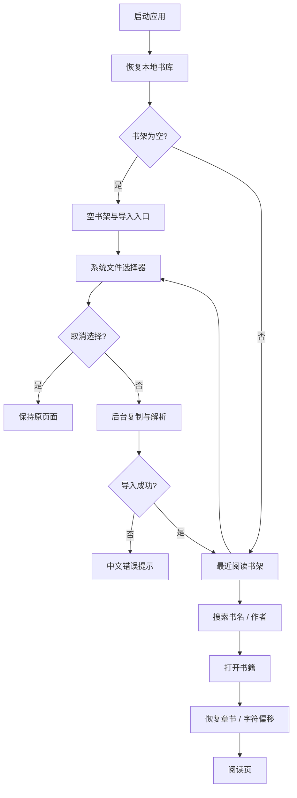
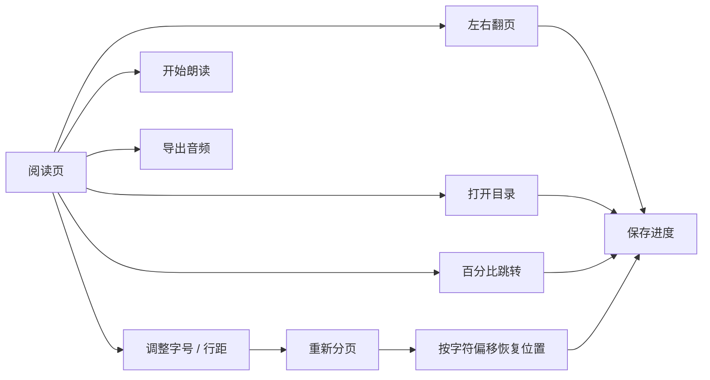
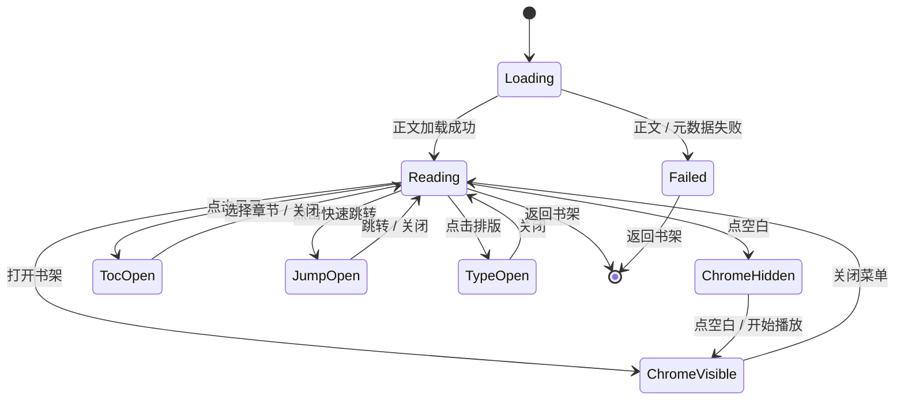
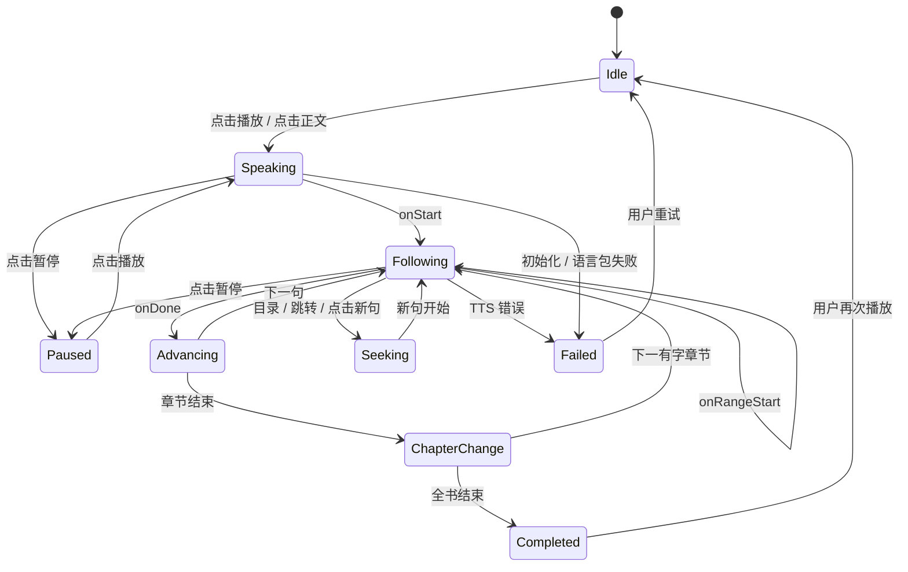
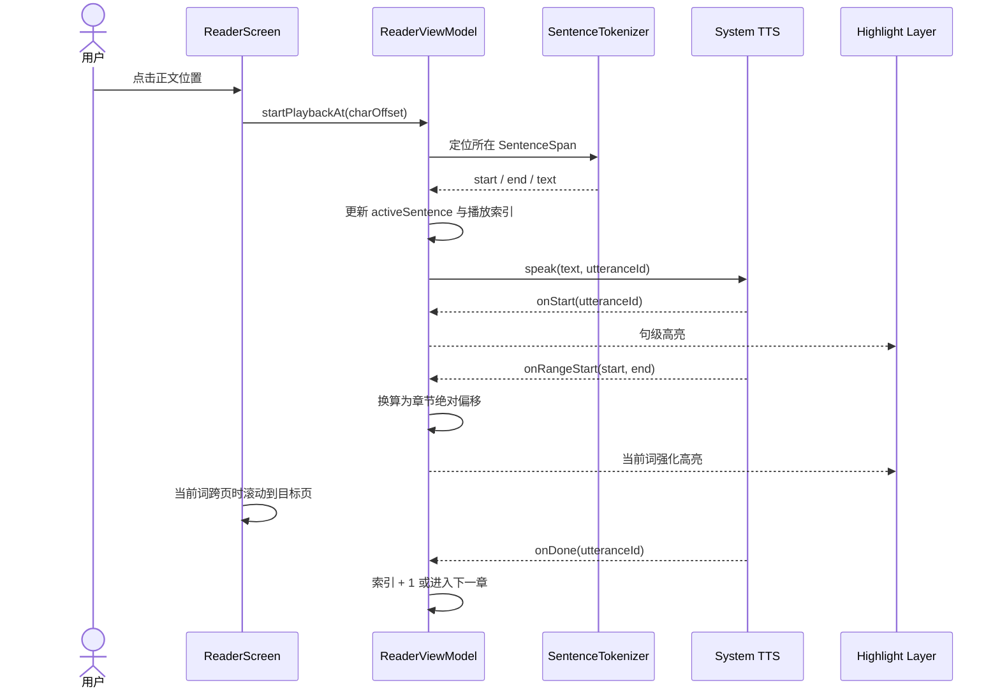
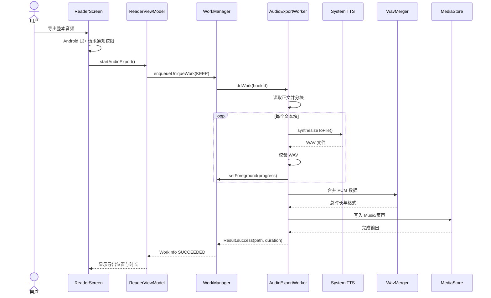
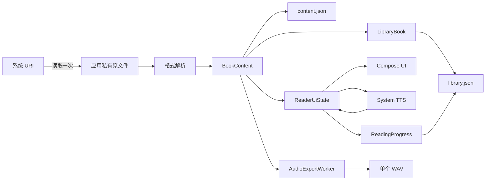
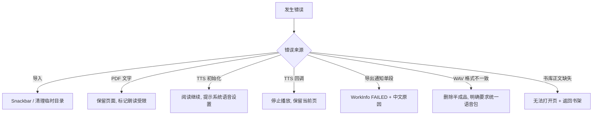

# 流程图、用户路径与状态机

本文聚焦“谁在什么状态下做了什么”。软件分层见 [软件架构框架图](04-architecture.md)，实现阶段细节见 [核心执行流水线](02-execution-pipeline.md)。

## 1. 用户主流程

## 2. 阅读流程

### 文本页点击规则

- 点击正文：从点击位置所在句开始朗读。
- 点击页边空白：显示或隐藏工具栏。
- 左右滑动：翻页。
- 工具栏隐藏且未播放：保留右下角耳机入口。

## 3. 阅读器 UI 状态

## 4. 播放状态机

## 5. TTS 同步时序

### 为什么 utteranceId 必须唯一且可验证

播放、暂停、跳转可能连续发生时，旧引擎回调仍可能晚到。`utteranceId` 内含章节与句子索引；接收回调前先校验当前期望值，避免旧句子把新位置的高亮或队列改坏。

## 6. 音频导出时序

## 7. 数据流

## 8. 失败路径

## 9. 设备验收必须覆盖的状态转换

1. 阅读中播放，用户连滑三页，再等待自动续句。
2. 播放中打开目录并跳到另一章。
3. 播放中锁屏、切后台、返回应用。
4. 暂停后滑页，再点击播放。
5. 系统 TTS 不支持词位置时验证句级降级。
6. 导出时切后台，完成通知与 WorkInfo 一致。
7. 导出中退出阅读页，再重新打开同一本书。
8. 扫描 PDF 无法朗读时仍能翻页与跳转。
