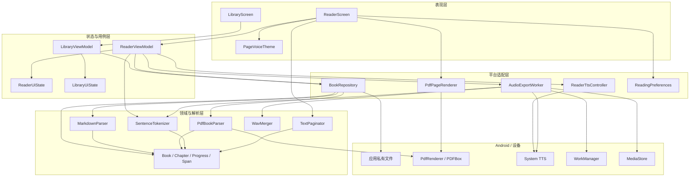
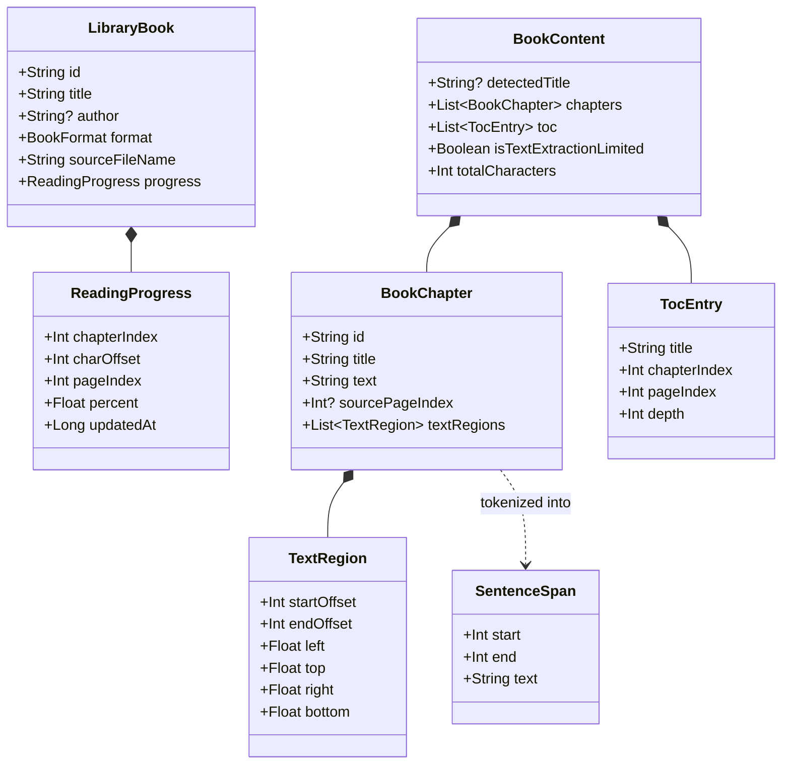
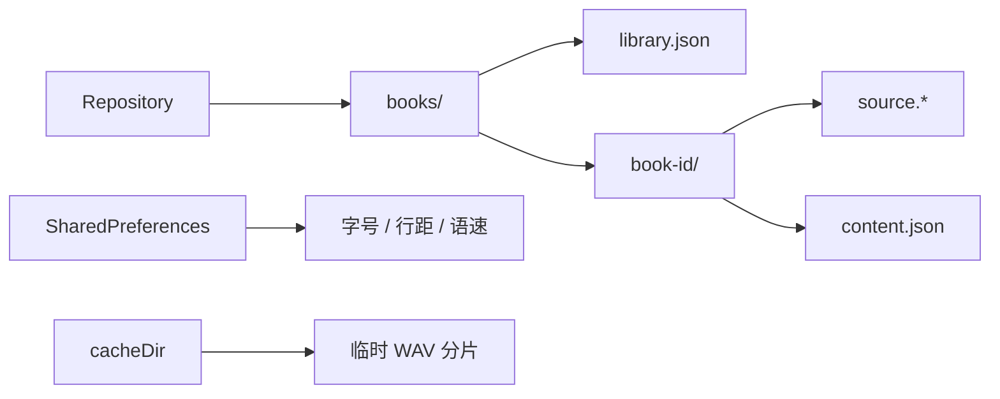
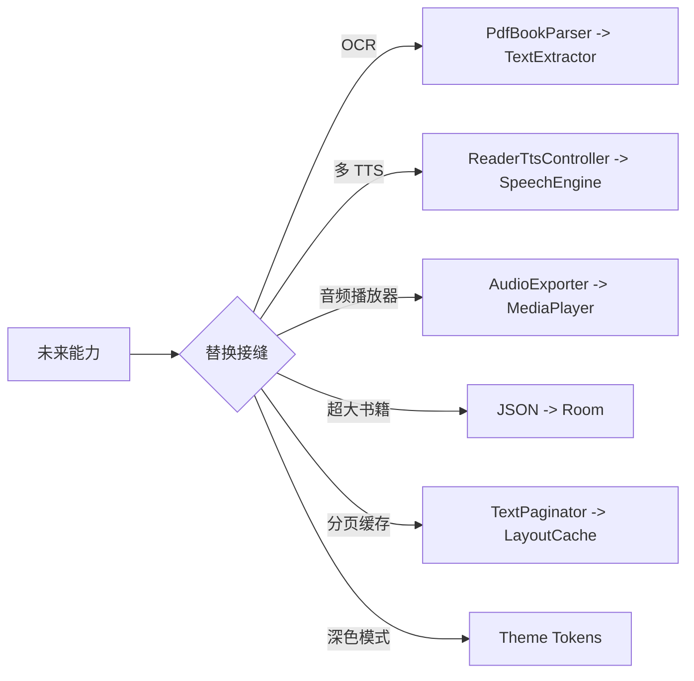

# 软件架构框架图

## 1. 架构目标

- 阅读与朗读共享同一份原文模型。
- UI 不直接依赖 PDFBox、文件系统或 TTS 细节。
- 平台能力通过清晰边界接入，方便后续替换 OCR、TTS 引擎或媒体播放器。
- 本地优先，首版没有网络权限与远端服务。
- 允许代码在 `minSdk 26` 的旧 Android 和兼容鸿蒙设备上运行。

## 2. 系统上下文

```mermaid
flowchart LR
    User[读者] -->|导入 / 阅读 / 播放 / 导出| App[页声 Android App]
    App --> SAF[Android 文件选择器]
    App --> PdfRenderer[系统 PdfRenderer]
    App --> TTS[系统 TextToSpeech 引擎]
    App --> WorkManager[Android WorkManager]
    App --> MediaStore[系统 MediaStore / 应用专属目录]

    SAF --> App: PDF / MD / TXT
    PdfRenderer --> App: PDF 页面位图
    TTS --> App: 播放 / 词位置 / WAV 分片
    WorkManager --> App: 后台任务与结果
    App --> MediaStore: 合成的 WAV
```

没有云端组件。系统文件选择器、PDF 渲染器、TTS 和媒体库都是设备上的 Android 平台能力。

## 3. 分层架构



### 依赖方向

```text
Presentation -> State -> Domain -> Platform abstraction
                         \-> Android platform
```

首版为了保持工程轻量，`ViewModel` 仍直接创建部分平台适配对象。后续如增加多语音引擎或 OCR，应通过接口反转这些依赖，而不是继续堆条件分支。

## 4. 模块职责

| 层 | 模块 | 职责 | 不应承担 |
| --- | --- | --- | --- |
| 表现 | `LibraryScreen` | 书架、搜索、导入入口、删除确认 | 文件解析、TTS |
| 表现 | `ReaderScreen` | 分页组合、翻页、目录、PDF 页面与高亮 | 书库持久化 |
| 状态 | `LibraryViewModel` | 导入与删除任务编排、书架状态 | PDF 坐标计算 |
| 状态 | `ReaderViewModel` | 阅读位置、播放队列、进度保存、导出触发 | Compose 绘制 |
| 领域 | `MarkdownParser` | 文本解码、章节与目录 | 文件选择 UI |
| 领域 | `PdfBookParser` | 页文字、书签、归一化行坐标 | 页面 Bitmap 绘制 |
| 领域 | `SentenceTokenizer` | 句子和原文偏移 | TTS 生命周期 |
| 领域 | `TextPaginator` | 按真实排版生成页面切片 | 保存阅读进度 |
| 领域 | `WavMerger` | 校验并合并 PCM WAV | WorkManager 调度 |
| 平台 | `BookRepository` | 文件复制、JSON 持久化、进度 | 页面显示 |
| 平台 | `ReaderTtsController` | 系统 TTS 生命周期与回调 | 句子切分 |
| 平台 | `AudioExportWorker` | 后台合成、MediaStore 输出 | 阅读界面状态 |

## 5. 核心数据模型



### 原文偏移契约

`SentenceSpan.start/end`、`TextRegion.startOffset/endOffset` 和 `ReadingProgress.charOffset` 必须指向同一章节字符串。任何解析器都不能把清洗后的文本偏移套到原 Markdown 字符串上。

当前文本解析器直接生成清洗后的章节正文，因此偏移基准是 `BookChapter.text`。PDF 解析器也从自己累积的纯文本建立偏移。这两个基准各自自洽，不跨格式混用。

## 6. 线程与生命周期

| 工作 | 线程 / 容器 |
| --- | --- |
| 文件复制、PDF 解析、JSON I/O | `Dispatchers.IO` |
| Compose 排版测量、页面绘制 | 主线程 |
| PDF Bitmap 渲染 | `Dispatchers.IO` + `produceState` |
| TTS 初始化、播放控制 | 主线程 |
| 音频导出 | WorkManager `CoroutineWorker` |
| 书库与状态广播 | `StateFlow` |
| 书籍删除 / 进度写入 | Repository `Mutex` + AtomicFile |

`ReaderViewModel` 销毁时释放前台 TTS；后台音频导出不受阅读页关闭影响，由 WorkManager 管理。

## 7. 持久化



- `library.json`：原子文件写入。
- `content.json`：导入时一次生成。
- `source.*`：原始文件副本，不修改。
- `SharedPreferences`：用户排版和语速偏好。
- `cacheDir/audio-export-*`：导出临时目录，结束或失败后清理。

## 8. 扩展接缝



推荐演进顺序：

1. 先完成 API 26 / API 35 编译与设备验证。
2. 用真实语料确定分页性能，再决定 Room 与分页缓存。
3. 抽象语音引擎接口，支持系统默认引擎及其回退。
4. OCR 作为 PDF 解析增强，不污染阅读 UI。
5. 品牌确定后统一包名与仓库结构。

## 9. 架构风险

| 风险 | 影响 | 当前缓解 | 下一步 |
| --- | --- | --- | --- |
| PDFBox 与 PdfRenderer 坐标差异 | 高亮偏移 | 保存归一化行框 | 旋转/裁剪/双栏真机矩阵 |
| 厂商 TTS 差异 | 播放或导出失败 | 明确错误与格式校验 | 语音引擎选择与能力探测 |
| 大数据全部 JSON | 导入/内存压力 | 正文与元数据拆分 | Room + 分页缓存 |
| UI 首次测量整本书 | 首屏卡顿 | 当前仅小中样例 | 增量分页与后台预计算 |
| 后台任务被杀 | 长导出中断 | WorkManager | 分段 checkpoint |
| 包名含临时个人标识 | 正式发布不便 | 文档记录待改 | 命名后迁移 applicationId |
